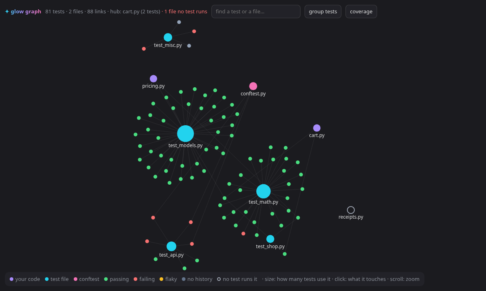
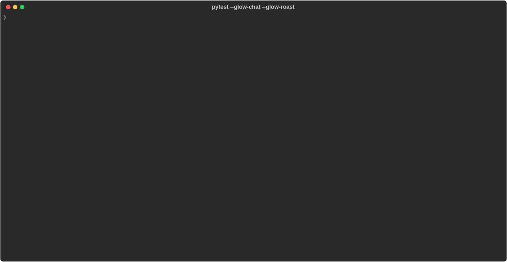
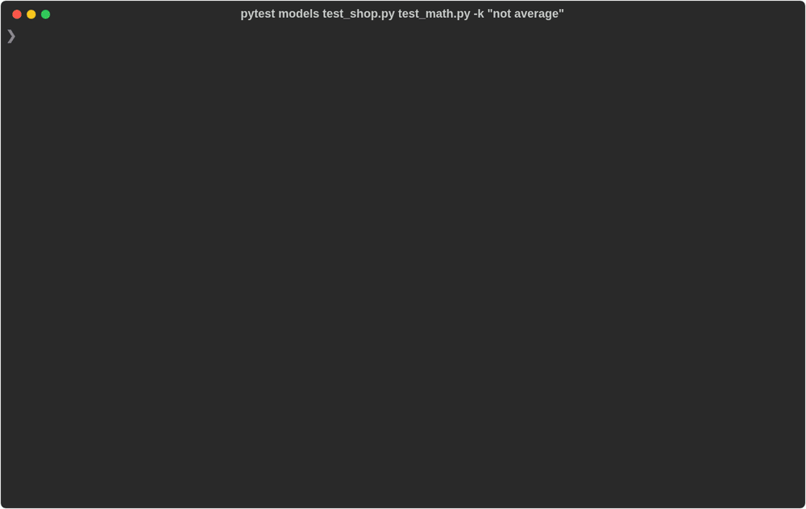

# pytest-glow

A live, [rich](https://github.com/Textualize/rich)-powered reporter for pytest. Same tests, same
flags, same exit codes. You just get to watch them run instead of reading a row of dots.


## What you get

**While the tests run**
- a line per running file: a spinner, a segmented bar where every test lights up green, red or yellow, counts and a clock
- the test that's running right now, with a ticking timer once it gets slow, and after 3s the line it's stuck
  on, with the call it's waiting in (`⏳ api.py:6 fetch_user  replies.get(timeout=30)  → threading.py wait`)
- under pytest-xdist, a line per worker: what it's running, for how long, and how many tests it has done
- an overall progress bar with an ETA, which turns red the moment something fails
- failures as one-liners as soon as they happen, so you don't wait for the end of the run to see them
- a combo counter for passes in a row, heating up as it grows, and when one fails, the screen comes apart for
  a moment: C-C-C-COMBO BREAKER, then the diagnosis, SKILL ISSUE

**At the end**
- rich tracebacks: highlighted source, locals (without pytest's `@py_assert` noise), captured output
- diffs for failed `==` asserts on dicts, lists, sets, strings, numbers, dataclasses and namedtuples: only what
  changed, nested paths like `user.address.city`, changed characters lit up. The failure one-liners say it
  too: `role: 'user' → 'admin'` instead of `assert {'name': 'gra...active': True} == {...}`. Also under xdist
- for a failed `in`, the near misses: `'3 new messages'` not in the page, but `'3 new mesages'` at char 50;
  `'admin'` not in the roles, closest `[3] 'admins'`; `8080` not in the ports, closest `8081`. For `not in`,
  where it was found, lit up in its context
- failures that failed the same way (same place, same message) grouped under one traceback: a database
  that's down is one failure with "+39 more like this", not forty tracebacks
- warnings grouped by message, the slowest tests, a short list of what failed
- the slowest fixtures, with setup and teardown apart, per call, and their share of the run
- with `--glow-profile`, where the time goes: under each slow test `↳ test 12% · your code 61% · libs 27%
  (sqlalchemy)`, and for the whole run fixtures, tests, your code and libraries on one bar, with the
  libraries that take the most (`in fixtures: argon2 5.40s`). It samples the stack every 5 ms, so it costs
  about nothing; time in C code (a `sleep`, a socket, numpy) counts for the Python code that called it.
  On macOS it gets a look in only every ~45 ms, so a test needs half a second or so for a breakdown of its own
- tips, when something takes a good part of the run: `💡 auth_client is set up 54× at 108ms each: 5.85s, 49% of
  the run`, with what to do about it (`scope="module"`). With `--glow-profile`, also libraries slow on purpose
  (`💡 argon2 takes 7.46s, 63% of the run`: cheaper hashing in tests) and tests that sleep
- the tests that go online, and where to: `🌐 2 tests go online · example.com:443 test_github`. Localhost,
  docker and other private addresses don't count; it notes the connection, never blocks it
- paths you can click: tests, files and failures open in the editor (VS Code's terminal opens at the line)
- a verdict panel with the counts and a proportional bar
- the command to rerun just the failures (`pytest --lf` when there are many)

**While you work**
- `pytest --glow-watch`: reruns on every save, what failed last time and what you just changed first. The header
  says which files changed. Keys, no Enter needed: `f` only what failed, `c` only what a save affects
  (`--glow-affected` on every rerun, until `c` again; Python 3.12+), `p` only tests matching a `-k` pattern,
  `d` the failures again in pdb, enter everything once, `q` quits
- `--glow-ff`: runs first what likely fails: what failed last time, the test files you're editing (or the ones
  named after a module you're editing: `test_cart.py` for `shop/cart.py`), new tests and flaky ones
- `--glow-affected`: runs only the tests what you changed can affect. While tests run with it, glow notes which
  of the project's files each one runs code from (wider-scoped fixtures included); the next run picks the tests
  whose files changed since, new tests and what failed. `◎ affected: 22 of 138 tests · 22 changed
  (apps/services/month.py)`; nothing changed, nothing runs, and that's a pass. When no test runs code from a
  changed file (a module of constants), it can't tell who uses it and runs everything; a changed `conftest.py`
  runs the tests under it. Python files only: a changed JSON fixture isn't noticed. Python 3.12+ (it uses
  `sys.monitoring`, about 1% slower); works under xdist and with `--no-glow`. When it leaves tests out, coverage
  isn't counted (it would be that of the part that ran) and `--cov-fail-under` doesn't fail the run
- `--glow-rerun[=N]`: a failed test runs again, up to N times. One that then passes is called out as flaky with
  how it failed the first time, and the run is GREEN, BUT FLAKY rather than red. Works under xdist and in CI

**On GitHub Actions** the log stays plain pytest, and the run also lands on the run's page as a job summary:
the verdict, failures grouped with a link to the failing line at the commit and `==` diffs as one-liners,
flaky tests and the slowest ones. `PYTEST_GLOW_SUMMARY=0` or `glow_summary = false` turns it off.

**Across runs** (kept in `.pytest_cache`, nothing to set up)
- green streaks, and the tests that were just *fixed* or just *started failing*
- flaky tests, with their recent pass/fail trail
- "faster/slower than last run", tests that got slower than usual, a sparkline of recent runs
- on a red run, what changed in git since the last green one, with the files the failures point at first;
  and when nothing changed, a hint that it's likely flaky, the environment or data
- under each failure, what its history says: `red for 4 runs, same failure · passed 2 days ago at 3f9c2e1,
  5 commits back`. "a new failure" when it broke differently than last run, "on this commit" when it passed
  minutes ago on the very same commit (so it's your uncommitted change, or it's flaky)

**Pure showing off** (all of it remembered in `.pytest_cache` too)
- personal bests: the fastest green run for a given number of tests, `🏆 new PB` when you beat it
- the ghost of your personal best races the run: under the progress bar, a 👻 where the best run was by now,
  and `▲ 0.5s ahead` or `▼ 1.2s behind` (for suites that take 3 seconds or more)
- speedrun splits: each file against its own best, when it's more than noise: `▼200ms GOLD` for a new best,
  `▲100ms` behind it, and `3 gold splits` in the verdict. A file's slowdown shows the moment it finishes
- achievements, each unlocked once per project: First Blood, Phoenix, Night Owl, Minimalist, Sniper,
  Speedrunner, Surgeon, Clean Sweep, Centurion, Friday Deploy, Archaeologist, Glass Cannon, Unstoppable,
  Boss Slayer, Shiny Hunter
- XP for every run (passes, green, combos, fixed tests, boss kills) and levels with titles, from Print
  Debugger to The One Who Runs pytest. A level up gets confetti and its own jingle. Past Lv 50 comes a
  PRESTIGE: back to Lv 1 with a ★ before your level, for good
- one green run in 500 comes out ✦ SHINY ✦: gold verdict, sparkle, 250 bonus XP
- daily quests: three a day, the same all day ("fix 3 tests", "a ×50 combo", "red → green", "green before
  10am"…), with their progress in the verdict and XP when done. `PYTEST_GLOW_QUESTS=0` turns them off
- a burst of confetti over the verdict when you set a record or unlock something (never in CI or pipes)
- under each failure, who last touched the failing line and when, from `git blame`
- a duration sparkline next to each of the slowest tests, so you see the ones getting slower
- certain pass counts are acknowledged
- `--glow-boss`: the suite is a boss fight. Every test that doesn't fail is a hit on your project's nemesis
  (the same boss every time), every failure costs you one of three hearts. Below half its HP it gets
  ENRAGED, below a tenth it makes its LAST STAND, and once slain it drops loot: sixteen items, common to
  legendary, to collect per project
- `pytest --glow-bisect test_vat`: the commit that broke a test. Glow remembers the commit each test last
  passed at, and from there to HEAD runs only that test, a binary search: `💥 broke in 8fe8b3a “tax: new rate”
  Ann · 2 days ago`, with how it fails there and what the commit changed. It works in a git worktree of its
  own, so your checkout and uncommitted changes stay as they are; `test_vat@v1.2` starts from a commit you
  name. When it passes at HEAD, it tells you what breaks it isn't committed yet
- `pytest --glow-graph`: your tests and the code they run, as a graph in the browser, like Obsidian's. Files
  sized by how many tests use them, tests coloured by how they've been doing, hubs in the middle. Click
  a file to see what editing it would run, a test to see what it touches; drag, zoom, search, or group the
  tests by file. The files no test runs code from stand apart as rings; `coverage` colours the files by
  their last coverage. Built from `--glow-affected`'s map, so run with that once first. One HTML file, no
  network; `--glow-graph=graph.html` saves it there instead of opening it

  

- `pytest --glow-wrapped`: your project's year-in-review. Runs, time spent, green rate, level, records, a hall
  of shame (failed the most, flakiest, slowest), who you were this week (🦉 Night Owl, 🔁 Rerun Goblin, 🩹 Medic,
  🐇 Speed Demon…), the hours you test at, loot and achievements. Runs no tests
- `pytest --glow-adopt`: a pet for the project, and it's forever. It asks once; you sign by naming it, and
  there's no `--glow-abandon`. It lives outside the project's cache, so wiping that won't get rid of it. Every
  green run feeds it: an egg hatches into a rubber duck `__(•<`, a bug `ϵ('Θ')϶`, a crab, a cat or a blob, and
  it grows up from hatchling to elder. A red run makes it sick (`(=;ω;=) Pickle is sick ♥♥♥♡♡ · dies in 3 days
  without a green run`), and a week of nothing but red kills it: 🪦. It shows in the verdict of the runs you
  watch in a terminal, never in CI's
- `--glow-chat`: a stream chat beside the live view, `● LIVE · 1.2k watching`. The viewers are made up; what they
  react to isn't: `F in chat` and `who wrote test_vat` on a failure, `NOOOO the ×42` when it breaks a combo,
  `is the database in the room with us` on a ConnectionError, `ResidentSleeper` for a test past 3 seconds, `×50
  COMBO 🔥`, `skipped? coward`, and `GG EZ` or `uninstall` at the end. Viewers come with a combo and leave on a
  failure. Under the live view in a terminal narrower than 120 columns; in a terminal only
- `--glow-roast`: a line of abuse under every failure, aimed at what went wrong: `off by 0.5. so close, and yet
  so red.`, `is the database in the room with us right now?`, `you wrote this 10 minutes ago. it didn't last an
  hour.`, `red 4 runs in a row. at this point it's a feature.` In a terminal only
- `--glow-share`: the run as an SVG card, ready to post
- `--glow-sound`: 8-bit sounds, synthesized on the fly (nothing to license): a power-up at combo 10, 25, 50,
  100…, a C-C-C-stutter and a slide down on a COMBO BREAKER, hits and crits on the boss, then a level-clear
  jingle, an air horn for a record, or the sad trombone. Hear them all with `python -m pytest_glow.sound`







**Coverage**: with `pytest-cov` installed, its plain table is replaced by a bar per file, the missing line
ranges, per-file gains and drops since the last run, and the total plus `--cov-fail-under` in the verdict.

## Install

```sh
pip install pytest-glow          # or: uv add --dev pytest-glow
```

It's picked up automatically and turns on whenever pytest writes to a terminal. In CI and in pipes,
pytest's standard output stays.

To try it in a project without adding it as a dependency:

```sh
uv run --with pytest-glow pytest
```

## Usage

Just run `pytest`. Everything else is optional:

| | |
|---|---|
| `--no-glow` or `PYTEST_GLOW=0` | use pytest's standard output |
| `--glow` or `PYTEST_GLOW=1` | force it on, even without a terminal (no animation then) |
| `--glow-boss` or `PYTEST_GLOW_BOSS=1` | fight the suite as a boss; `glow_boss = true` in the ini to keep it on |
| `--glow-sound` or `PYTEST_GLOW_SOUND=1` | 8-bit sounds for combos, the boss and the end of the run (terminal only); `glow_sound = true` in the ini |
| `--glow-share[=PATH]` | save the run as an SVG card, `glow-card.svg` by default |
| `--glow-adopt [NAME]` | adopt a pet for this project, for good, and exit |
| `--glow-chat` or `PYTEST_GLOW_CHAT=1` | a stream chat beside the live view, reacting to the run (terminal only); `glow_chat = true` in the ini |
| `--glow-roast` or `PYTEST_GLOW_ROAST=1` | a line of abuse under every failure, aimed at what went wrong (terminal only); `glow_roast = true` in the ini |
| `--glow-cov-all` or `PYTEST_GLOW_COV_ALL=1` | list every file in the coverage table, the fully covered ones too; `glow_cov_all = true` in the ini |
| `--glow-profile` or `PYTEST_GLOW_PROFILE=1` | split test time into the test, your code, libraries and fixtures; `glow_profile = true` in the ini |
| `--glow-watch` | rerun on every save, failures and changed tests first; `f`, `c`, `p`, `d`, enter and `q` while it waits |
| `--glow-affected` or `PYTEST_GLOW_AFFECTED=1` | run only the tests that what changed can affect (Python 3.12+) |
| `--glow-ff` or `PYTEST_GLOW_FF=1` | run the likely failures first; `glow_ff = true` in the ini |
| `--glow-rerun[=N]` or `PYTEST_GLOW_RERUN=N` | rerun a failed test up to N times (1 by default) and call out flaky ones; `glow_rerun = N` in the ini |
| `PYTEST_GLOW_SUMMARY=0` | no job summary on GitHub Actions; `glow_summary = false` in the ini |
| `PYTEST_GLOW_QUESTS=0` | no daily quests |
| `--glow-bisect TEST[@COMMIT]` | find the commit that broke a test, in a worktree of its own, and exit |
| `--glow-graph[=PATH]` | draw the tests and the files they use as a graph in the browser and exit |
| `--glow-wrapped` | show everything glow remembers about the project and exit; with `--glow-share`, save it as SVG |
| `PYTEST_GLOW_LINK` | where clickable paths go, e.g. `pycharm://open?file={path}&line={line}`; `off` to turn them off |
| `-v` | also list every test as it finishes |
| `-q` | only failures and the final summary |
| `--tb=short/line/native` | pytest's own traceback text instead of rich tracebacks; `--tb=no` hides them |

glow steps aside on its own for modes that drive the terminal themselves: `--collect-only`,
`--fixtures`, `--markers`, `--setup-show`/`--setup-plan`, live logging (`log_cli`), `--debug`.

### Coverage

Use pytest-cov as usual:

```sh
pytest --cov=mypkg --cov-report=term-missing --cov-fail-under=90
```

`term`, `term-missing` and `skip-covered` are respected; html, xml and json reports are still written
as configured. Past 25 files the table keeps to the ones not fully covered; `--glow-cov-all` lists every
file, fully covered ones too, whatever `skip-covered` says. Plain `--cov` measures `[tool.coverage.run] source` from your config. Set it there, or
your tests get measured too.

## Compatibility

- Python 3.10+, pytest 8.0+
- Linux and macOS. On Windows glow only runs with an explicit `--glow` (it's untested there).
- Works with pytest-xdist, pytest-cov, `breakpoint()`/`--pdb`, `-x`, `-s`, `--durations`, and plugins that
  add their own terminal summary.
- Under xdist, tracebacks show pytest's highlighted text rather than rich tracebacks, since the exceptions stay
  in the worker processes (assertion diffs come along).
- Not supported yet: `-r` short-summary flags (`-rA`, `-rP`, ...) beyond the failure list.

## Try the demo

The repo has a showcase suite with slow, failing, flaky and skipped tests, warnings and a small package
for coverage:

```sh
uv sync
cd demo
uv run pytest
uv run pytest -n 4
uv run pytest test_shop.py --cov=shop --cov-report=term-missing --cov-fail-under=80
```

Run it a few times: the history features kick in from the second run.

## Development

```sh
uv sync                          # creates .venv with the plugin and dev tools
uv run pytest                    # the plugin's own tests
uv run ruff check src tests && uv run ruff format src tests
```

The tests run pytest in subprocesses (`pytester`) with `--glow` forced and check what comes out.

## License

MIT
