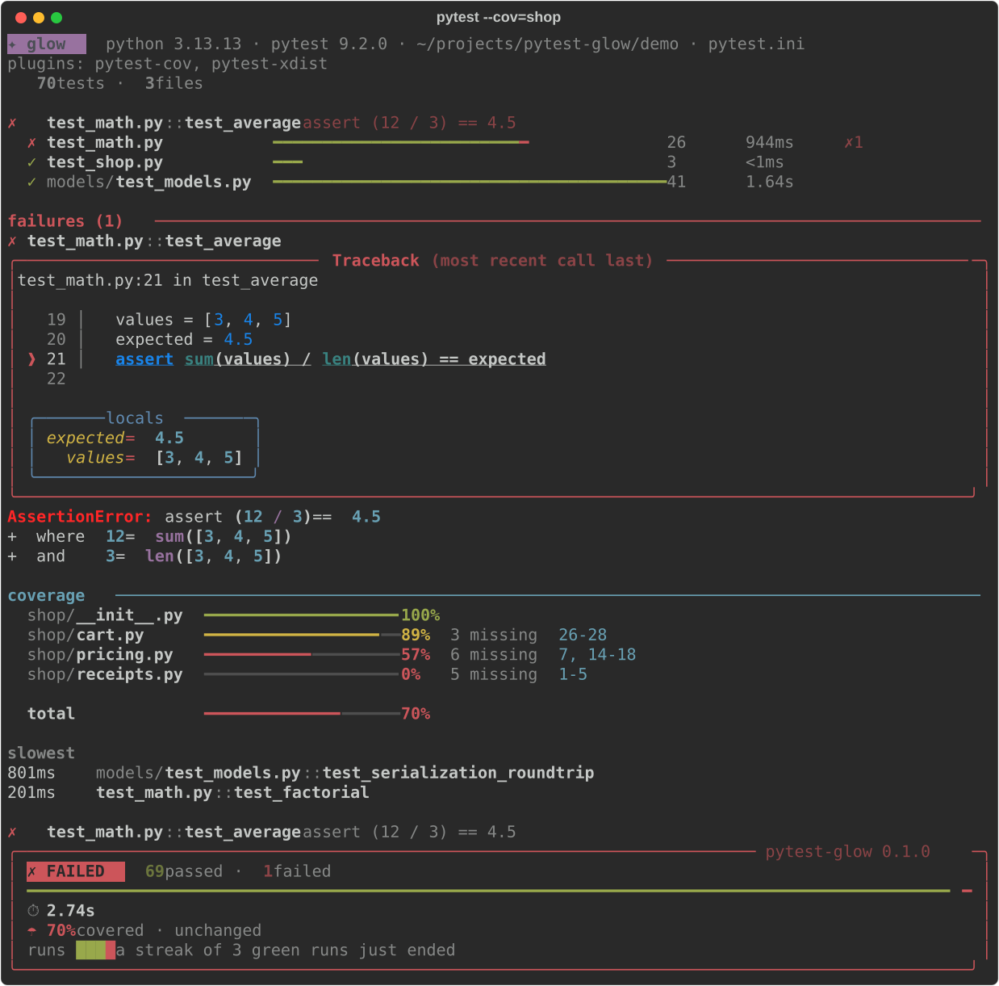

# pytest-glow

A live, [rich](https://github.com/Textualize/rich)-powered reporter for pytest. Same tests, same
flags, same exit codes. You just get to watch them run instead of reading a row of dots.



## What you get

**While the tests run**
- a line per running file: a spinner, a segmented bar where every test lights up green, red or yellow, counts and a clock
- the test that's running right now, with a ticking timer once it gets slow (hangs are easy to spot)
- an overall progress bar with an ETA, which turns red the moment something fails
- failures as one-liners as soon as they happen, so you don't wait for the end of the run to see them
- a combo counter for passes in a row, heating up as it grows, and a COMBO BREAKER when one fails

**At the end**
- rich tracebacks: highlighted source, locals (without pytest's `@py_assert` noise), captured output
- diffs for failed `==` asserts on dicts, lists, sets, strings, numbers, dataclasses and namedtuples: only what
  changed, nested paths like `user.address.city`, changed characters lit up. The failure one-liners say it
  too: `role: 'user' → 'admin'` instead of `assert {'name': 'gra...active': True} == {...}`
- warnings grouped by message, the slowest tests, a short list of what failed
- a verdict panel with the counts and a proportional bar
- the command to rerun just the failures (`pytest --lf` when there are many)

**Across runs** (kept in `.pytest_cache`, nothing to set up)
- green streaks, and the tests that were just *fixed* or just *started failing*
- flaky tests, with their recent pass/fail trail
- "faster/slower than last run", tests that got slower than usual, a sparkline of recent runs
- on a red run, what changed in git since the last green one, with the files the failures point at first;
  and when nothing changed, a hint that it's likely flaky, the environment or data

**Pure showing off** (all of it remembered in `.pytest_cache` too)
- personal bests: the fastest green run for a given number of tests, `🏆 new PB` when you beat it
- achievements, each unlocked once per project: First Blood, Phoenix, Night Owl, Minimalist, Sniper,
  Speedrunner, Surgeon, Clean Sweep, Centurion, Friday Deploy, Archaeologist, Glass Cannon, Unstoppable
- a burst of confetti over the verdict when you set a record or unlock something (never in CI or pipes)
- under each failure, who last touched the failing line and when, from `git blame`
- a duration sparkline next to each of the slowest tests, so you see the ones getting slower
- certain pass counts are acknowledged

**Coverage**: with `pytest-cov` installed, its plain table is replaced by a bar per file, the missing line
ranges, per-file gains and drops since the last run, and the total plus `--cov-fail-under` in the verdict.

## Install

```sh
pip install pytest-glow          # or: uv add --dev pytest-glow
```

It's picked up automatically and turns on whenever pytest writes to a terminal. In CI and in pipes,
pytest's standard output stays.

To try it in a project without adding it as a dependency:

```sh
uv run --with pytest-glow pytest
```

## Usage

Just run `pytest`. Everything else is optional:

| | |
|---|---|
| `--no-glow` or `PYTEST_GLOW=0` | use pytest's standard output |
| `--glow` or `PYTEST_GLOW=1` | force it on, even without a terminal (no animation then) |
| `-v` | also list every test as it finishes |
| `-q` | only failures and the final summary |
| `--tb=short/line/native` | pytest's own traceback text instead of rich tracebacks; `--tb=no` hides them |

glow steps aside on its own for modes that drive the terminal themselves: `--collect-only`,
`--fixtures`, `--markers`, `--setup-show`/`--setup-plan`, live logging (`log_cli`), `--debug`.

### Coverage

Use pytest-cov as usual:

```sh
pytest --cov=mypkg --cov-report=term-missing --cov-fail-under=90
```

`term`, `term-missing` and `skip-covered` are respected; html, xml and json reports are still written
as configured. Plain `--cov` measures `[tool.coverage.run] source` from your config. Set it there, or
your tests get measured too.

## Compatibility

- Python 3.10+, pytest 8.0+
- Linux and macOS. On Windows glow only runs with an explicit `--glow` (it's untested there).
- Works with pytest-xdist, pytest-cov, `breakpoint()`/`--pdb`, `-x`, `-s`, `--durations`, and plugins that
  add their own terminal summary.
- Under xdist, tracebacks show pytest's highlighted text rather than rich tracebacks and assertion diffs, since
  the exceptions stay in the worker processes.
- Not supported yet: `-r` short-summary flags (`-rA`, `-rP`, ...) beyond the failure list.

## Try the demo

The repo has a showcase suite with slow, failing, flaky and skipped tests, warnings and a small package
for coverage:

```sh
uv sync
cd demo
uv run pytest
uv run pytest -n 4
uv run pytest test_shop.py --cov=shop --cov-report=term-missing --cov-fail-under=80
```

Run it a few times: the history features kick in from the second run.

## Development

```sh
uv sync                          # creates .venv with the plugin and dev tools
uv run pytest                    # the plugin's own tests
uv run ruff check src tests && uv run ruff format src tests
```

The tests run pytest in subprocesses (`pytester`) with `--glow` forced and check what comes out.

## License

MIT
